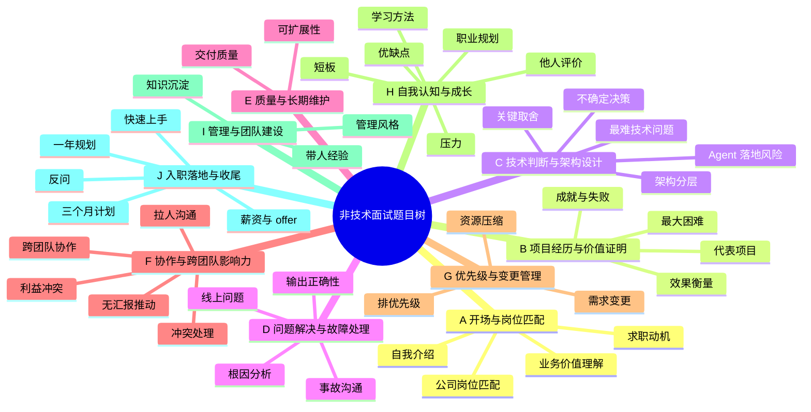

# 非技术面试题目树

> 覆盖三份面试文档，共 **54 道题**（含跨轮次重复出现的变体）。按能力维度而非面试轮次分类，便于横向对比、查漏补缺和复用同一套项目故事。
>
> 出处标记：`四面-1`～`四面-5` 为 HRBP 面第一部分；`四面-常见-N` 为 HRBP 面第二部分；`二面-N`、`三面-N` 分别为主管面、交叉主管面。

---

## 一、题目树总览

### 树形清单

- **A. 开场与岗位匹配**
    - A1 自我介绍（主管面版）
    - A2 自我介绍（HRBP 版）
    - A3 用一句话介绍你自己，并说说为什么适合这个岗位
    - A4 为什么想换工作
    - A5 为什么选择我们公司 / 这个岗位
    - A6 为什么选择我们 + 打算待多久
    - A7 怎么理解这个岗位 / 方向的业务价值
- **B. 项目经历与价值证明**
    - B1 详细介绍一个最有代表性的项目
    - B2 遇到的最大困难是什么、如何解决
    - B3 最大的困难是技术问题还是业务问题
    - B4 最有成就感的一件事
    - B5 讲一次失败或受挫的经历
    - B6 怎么衡量这个项目做得好不好
- **C. 技术判断与架构设计**
    - C1 整体架构怎么设计、为什么这么分层
    - C2 项目里最关键的取舍是什么
    - C3 项目里最难的技术问题及解决过程
    - C4 信息不充分时怎么做技术决策
    - C5 怎么看 Agent 这两年的落地风险
- **D. 问题解决与故障处理**
    - D1 不懂测试流程，怎么判断 Agent 输出对不对
    - D2 出了问题，怎么和业务同事一起找根因
    - D3 线上出过什么问题、怎么处理
    - D4 线上事故的对内对外沟通
- **E. 质量、评测与长期维护**
    - E1 怎么保证交付质量
    - E2 怎么保证方案的可扩展性和长期可维护性
- **F. 协作、沟通与跨团队影响力**
    - F1 怎么拉人、怎么和测试同事沟通
    - F2 讲一个推动跨团队协作的项目
    - F3 方案和其他团队利益冲突时怎么处理
    - F4 怎么让不向你汇报的人配合你
    - F5 团队协作中的角色 + 怎么推动他人
    - F6 和同事意见不一致或发生冲突怎么处理
    - F7 领导安排你不认同的任务怎么办
    - F8 和直属领导意见不一致怎么办
    - F9 在团队里通常扮演什么角色
- **G. 优先级、资源与变更管理**
    - G1 需求很多、资源有限时怎么排优先级
    - G2 需求突然变更或紧急插队怎么处理
    - G3 资源被抽走、排期被压缩怎么办
- **H. 自我认知、成长与职业规划**
    - H1 优点和缺点
    - H2 领导和同事怎么评价你
    - H3 目前最需要提升的是什么
    - H4 平时怎么学习新技术
    - H5 怎么看待加班和压力
    - H6 未来 3 到 5 年的职业规划
- **I. 管理与团队建设**
    - I1 有没有带人或知识沉淀的经验
    - I2 怎么做知识沉淀和团队赋能
    - I3 希望加入什么样的团队、喜欢什么管理风格
- **J. 入职落地与收尾**
    - J1 从 0 搭建这个方向，前三个月怎么做
    - J2 入职后未来一年怎么开展工作
    - J3 入职后怎么快速上手
    - J4 反问（HRBP 版）
    - J5 反问（主管面版）
    - J6 反问（交叉面版）
    - J7 对团队 / 业务的建议与疑问
    - J8 期望薪资
    - J9 目前还有其他 offer 吗

---

## 二、分类明细

### A. 开场与岗位匹配

| 编号 | 题目 | 出处 | 考察点 |
|---|---|---|---|
| A1 | 请先做一个自我介绍 | 二面-1 | 表达结构、与岗位的匹配度 |
| A2 | 请做一个简单的自我介绍 | 四面-常见-1 | 动机、方向一致性、稳定性 |
| A3 | 用一句话介绍自己，并说说为什么适合这个岗位 | 三面-1 | 自我定位是否清晰、能否一句话讲清价值 |
| A4 | 为什么想换工作？ | 四面-常见-2 | 离职原因是否健康、是否有回避风险 |
| A5 | 为什么选择我们公司 / 这个岗位？ | 四面-常见-3 | 求职动机、对公司的了解程度 |
| A6 | 为什么选择我们？你打算待多久？ | 三面-14 | 长期性、稳定性、预期是否现实 |
| A7 | 你怎么理解这个岗位 / 这个方向的业务价值？ | 三面-2 | 业务视角、价值判断、是否只看技术 |

**这一类的主线：** 年限与方向 → 一个能证明能力的项目 → 与岗位的 2～3 个匹配点 → 为什么是这家公司。自我介绍准备 1 分钟和 2 分钟两个版本；回答"为什么来"时，把公司业务、岗位职责、个人方向三者连起来，不要只夸公司。

### B. 项目经历与价值证明

| 编号 | 题目 | 出处 | 考察点 |
|---|---|---|---|
| B1 | 详细介绍一个你最有代表性的项目 | 二面-2 | 项目复杂度、个人贡献、结果意识 |
| B2 | 遇到的最大困难是什么？如何解决？ | 四面-1 | 真实难点、解决路径、反思深度 |
| B3 | 你最大的困难到底是技术问题，还是业务问题？ | 四面-5 | 能否抓住主要矛盾、是否有业务思维 |
| B4 | 你最有成就感的一件事是什么？ | 四面-常见-7 | 价值导向、对"做好"的定义 |
| B5 | 讲一次失败或受挫的经历 | 四面-常见-8 | 复盘能力、是否敢于承认问题 |
| B6 | 你怎么衡量这个项目做得好不好？ | 二面-5 | 指标意识、业务价值与技术指标的结合 |

**这一类的主线：** 统一用"背景—职责—做法—结果—反思"讲。项目故事只准备一个主版本（AI4Test），再针对不同问题抽取不同侧面：讲困难抽"业务经验显性化"，讲技术抽"跑到一半的状态恢复"，讲价值抽"使用率与人工修改率"。指标优先说真实数据，没有精确数据就用可解释的定性描述。

### C. 技术判断与架构设计

| 编号 | 题目 | 出处 | 考察点 |
|---|---|---|---|
| C1 | 这个项目的整体架构是怎么设计的？为什么这么分层？ | 二面-3 | 架构思维、分层依据、对代价的认知 |
| C2 | 项目里最关键的取舍是什么？ | 二面-4 | 技术判断、边界感、是否理解业务约束 |
| C3 | 项目里最难的技术问题是什么？你是怎么解决的？ | 二面-8 | 技术深度、排查方法、能否抽象出通用问题 |
| C4 | 信息不充分的时候，你怎么做技术决策？ | 三面-7 | 不确定性下的判断、可逆性思维 |
| C5 | 你怎么看 Agent 这两年的落地风险？有哪些是被高估的？ | 三面-8 | 行业判断、风险意识、是否盲目追热点 |

**这一类的主线：** 架构题不要只报流水账，按"分了几层—每层解决什么—为什么这样分—代价是什么—怎么补"来讲。取舍题至少准备三组：动态 vs 确定性、效果 vs 成本时延、自研 vs 复用。风险题要敢下判断，同时给出边界条件，避免一味唱多或唱空。

### D. 问题解决与故障处理

| 编号 | 题目 | 出处 | 考察点 |
|---|---|---|---|
| D1 | 测试流程不懂，怎么知道 Agent 生成的测试步骤对不对？ | 四面-3 | 验证机制、评测意识、业务标准 |
| D2 | 出了问题，你怎么和业务同事一起找根因？ | 四面-4 | 排查方法论、协作姿态、证据意识 |
| D3 | 线上出过什么问题？你是怎么处理的？ | 二面-9 | 应急能力、止损意识、复盘机制 |
| D4 | 线上事故发生时，你怎么做对内和对外的沟通？ | 三面-10 | 透明度、口径管理、责任意识 |

**这一类的主线：** 统一按"先止损—再复现—后定位—再复盘"讲。定位时沿着"需求理解 → 知识检索 → 任务规划 → 工具调用 → 执行环境 → 结果校验"逐层排除，强调用证据而不是先入为主。事故沟通记住三点：及时、准确、统一口径；复盘对事不对人。

### E. 质量、评测与长期维护

| 编号 | 题目 | 出处 | 考察点 |
|---|---|---|---|
| E1 | 你怎么保证交付质量？ | 二面-10 | 质量体系、评测集、灰度与回滚 |
| E2 | 你怎么保证方案的可扩展性和长期可维护性？ | 三面-11 | 契约与边界、抽象时机、可观测性 |

**这一类的主线：** 质量不是最后测一遍，而是分层测试 + 评测集回归 + 灰度 + 可观测 + 可回滚。AI 应用尤其要强调"评测集就是回归测试"。可扩展性强调三点：边界与契约、不要过早抽象、可观测可回滚。

### F. 协作、沟通与跨团队影响力

| 编号 | 题目 | 出处 | 考察点 |
|---|---|---|---|
| F1 | 你具体怎么拉人、怎么和测试同事沟通？ | 四面-2 | 推动力、共情、协作机制设计 |
| F2 | 讲一个你推动跨团队协作的项目，你是怎么做的？ | 三面-3 | 跨团队影响力、目标对齐、机制建设 |
| F3 | 当你的方案和其他团队的利益发生冲突时，你怎么处理？ | 三面-4 | 冲突处理、上位目标、决策升级 |
| F4 | 你怎么让不向你汇报的人配合你？ | 三面-6 | 非职权影响力、降低对方成本 |
| F5 | 在团队协作中你通常是什么角色？怎么推动不向你汇报的人？ | 二面-11 | 自我定位、推动方法、风险同步 |
| F6 | 和同事意见不一致或者发生冲突时，你怎么处理？ | 四面-常见-9 | 情绪管理、对事不对人 |
| F7 | 如果领导安排了一件你不认同的任务，你会怎么做？ | 四面-常见-15 | 职业性、执行力、风险意识 |
| F8 | 如果你和直属领导意见不一致，你会怎么做？ | 二面-13 | 向上沟通、决策后的执行 |
| F9 | 在团队里你通常扮演什么角色？ | 四面-常见-14 | 团队定位、主动性、补位意识 |

**这一类的主线：** 推动他人靠三件事：共同目标、降低参与成本、用可见结果建立信任。冲突处理先还原成"目标与约束的冲突"，再找上位目标；无法兼顾时把选项和影响交给决策方。和领导不一致时，先补信息、私下沟通、给替代方案，决定后执行并留好风险预案。

### G. 优先级、资源与变更管理

| 编号 | 题目 | 出处 | 考察点 |
|---|---|---|---|
| G1 | 需求很多、资源有限时，你怎么排优先级？ | 二面-6 | 目标对齐、价值判断、取舍与同步 |
| G2 | 项目进行中需求突然变更，或者被紧急插队，你怎么处理？ | 二面-7 | 变更管理、选项思维、留痕 |
| G3 | 如果资源被抽走、排期被压缩，你会怎么办？ | 三面-5 | 范围拆分、风险前置、可持续性 |

**这一类的主线：** 先对齐目标，再按"价值 × 紧迫性 / 成本与风险"排序，明确"不做什么"并同步。变更不要直接拒绝，也不要默默硬扛：判断性质 → 给出"砍范围 / 加资源 / 延期 / 临时方案"选项 → 让决策者选 → 更新排期并留痕。资源不足时反对用长期加班掩盖问题。

### H. 自我认知、成长与职业规划

| 编号 | 题目 | 出处 | 考察点 |
|---|---|---|---|
| H1 | 你的优点和缺点分别是什么？ | 四面-常见-5 | 自我认知是否真实、是否有改进行动 |
| H2 | 你的领导和同事一般怎么评价你？ | 四面-常见-6 | 他人视角、口碑一致性 |
| H3 | 你觉得自己目前最需要提升的是什么？ | 三面-13 | 坦诚度、成长意识、是否回避核心短板 |
| H4 | 你平时怎么学习新技术？ | 四面-常见-13 | 学习方法、动手能力、知识沉淀 |
| H5 | 你怎么看待加班和压力？ | 四面-常见-10 | 工作观、抗压方式、边界感 |
| H6 | 你未来 3 到 5 年的职业规划是什么？ | 四面-常见-4 | 方向感、稳定性、与岗位的匹配 |

**这一类的主线：** 优缺点不要用"我太追求完美"这类伪缺点，说一个真实、可改进、且不致命的短板，并给出具体动作。职业规划要落在"技术深度 + 业务理解"上，和岗位方向一致，避免空泛地谈管理。加班问题表达"关键节点愿意投入，但反对用加班掩盖规划问题"。

### I. 管理与团队建设

| 编号 | 题目 | 出处 | 考察点 |
|---|---|---|---|
| I1 | 你有带人或者做知识沉淀的经验吗？ | 二面-12 | 带人方式、是否愿意做基础工作 |
| I2 | 你怎么做知识沉淀和团队赋能？ | 三面-12 | 复用意识、流程化思维、分享能力 |
| I3 | 你希望加入什么样的团队？喜欢什么样的管理风格？ | 二面-14 | 自我管理方式、与团队的契合度 |

**这一类的主线：** 没有正式带团队就如实说，用"带新人 / 方案评审 / 技术分享 / 推动规范"来证明。知识沉淀的标准不是写了多少文档，而是"别人能不能不问我，就把这件事做对"。管理风格上表达"目标清楚 + 充分授权 + 及时反馈"，同时说明自己会主动补位。

### J. 入职落地与收尾

| 编号 | 题目 | 出处 | 考察点 |
|---|---|---|---|
| J1 | 如果让你从 0 搭建这个方向，前三个月你会怎么做？ | 三面-9 | 规划能力、节奏感、是否务实 |
| J2 | 如果入职，你未来一年打算怎么开展工作？ | 二面-15 | 落地路径、阶段目标、融入意识 |
| J3 | 入职后你打算怎么快速上手？ | 四面-常见-16 | 学习路径、主动性、协作方式 |
| J4 | 你还有什么问题想问我们？ | 四面-常见-17 | 关注点、准备程度、是否只关心薪资 |
| J5 | 你还有什么问题想问我们？ | 二面-16 | 对岗位目标与团队分工的理解 |
| J6 | 你还有什么问题想问我们？ | 三面-16 | 长期视角、对团队能力的判断 |
| J7 | 基于你目前的了解，你对我们团队或业务有什么建议或疑问？ | 三面-15 | 观察力、分寸感、业务思考 |
| J8 | 你的期望薪资是多少？ | 四面-常见-11 | 自我定价、沟通技巧 |
| J9 | 你目前还有其他 offer 吗？ | 四面-常见-12 | 求职状态、选择标准、诚信 |

**这一类的主线：** 落地规划统一按"先融入、再交付、后优化"讲；从 0 搭建按"选场景—跑闭环—建机制"讲。反问不要问薪资福利，优先问：岗位半年目标、团队最痛的问题、成功标准、协作方式、对失败的容忍度。薪资给区间和依据，强调更关注成长空间。

---

## 三、高频必背 12 题

| 优先级 | 题目 | 编号 | 回答主线 |
|---|---|---|---|
| 1 | 详细介绍一个最有代表性的项目 | B1 | 背景—职责—做法—结果—反思，控制在 2～3 分钟 |
| 2 | 整体架构怎么设计、为什么这么分层 | C1 | 接入层 / 网关 / 运行时 / 编排层；解耦、故障边界、独立演进；代价是可观测 |
| 3 | 项目里最难的技术问题 | C3 | "跑到一半"的状态：in_flight / uncertain + 恢复核对 + 幂等 |
| 4 | 遇到的最大困难 | B2 | 业务经验显性化：补认知 → 沉淀规则 → 评测迭代 |
| 5 | 出了问题怎么找根因 | D2 | 止损—复现—分层定位—回归沉淀；证据优先 |
| 6 | 怎么拉人、怎么和测试同事沟通 | F1 | 关键人 → 降低参与成本 → 固定协作机制 → 用对方语言 |
| 7 | 讲一个跨团队协作项目 | F2 | 目标翻译 → 小范围闭环 → 机制固定 → 从"我推"变"他们提" |
| 8 | 需求多、资源有限怎么排优先级 | G1 | 对齐目标 → 价值/紧迫/成本风险 → 明确不做什么 → 同步 |
| 9 | 需求变更或紧急插队 | G2 | 判断性质 → 给选项 → 决策者选 → 更新排期留痕 |
| 10 | 优缺点 / 最需要提升的点 | H1 / H3 | 真实短板 + 具体改进行动，不用伪缺点 |
| 11 | 为什么选择我们、打算待多久 | A5 / A6 | 方向匹配 + 场景复杂 + 团队务实；按长期考虑 |
| 12 | 你有什么问题想问我们 | J4～J6 | 半年目标、团队最痛的问题、成功标准、协作方式 |

---

## 四、按面试轮次索引

| 轮次 | 考察重点 | 对应题目 |
|---|---|---|
| **HRBP 面（四面）** | 动机、稳定性、文化匹配、沟通风格、薪酬预期 | A2、A4、A5、B2、B3、B4、B5、D1、D2、F1、F6、F7、F9、H1、H2、H4、H5、H6、J3、J4、J8、J9 |
| **主管面（二面）** | 项目深度、技术判断、交付质量、协作与带人 | A1、B1、B6、C1、C2、C3、D3、E1、F5、F8、G1、G2、I1、I3、J2、J5 |
| **交叉主管面（三面）** | 业务价值、跨团队影响力、不确定性决策、长期视角 | A3、A6、A7、C4、C5、D4、E2、F2、F3、F4、G3、H3、I2、J1、J6、J7 |

**轮次差异提示：**

- 四面少讲技术细节，多讲动机、协作、稳定性和自我认知。
- 二面要能经得起项目追问，架构、取舍、故障处理必须有自己的判断。
- 三面少讲实现，多讲业务价值、跨团队推动、风险判断和长期规划。

---

## 五、题目变体归并

同一类问题在不同轮次会换说法，建议用同一套素材，只调整详略和侧重点。

| 主题 | 出现的题目 | 准备策略 |
|---|---|---|
| 自我介绍 | A1、A2、A3 | 准备 1 分钟 / 2 分钟 / 一句话三个版本 |
| 求职动机 | A4、A5、A6 | 离职原因讲发展性理由；选择公司讲方向、场景、团队 |
| 最大困难 | B2、B3、C3 | 业务困难讲"经验显性化"；技术困难讲"状态恢复" |
| 跨团队推动 | F1、F2、F4、F5 | 统一用"共同目标 + 降成本 + 小闭环 + 机制" |
| 冲突与不一致 | F3、F6、F7、F8 | 先还原目标与约束，再给选项，决定后执行 |
| 质量与正确性 | D1、E1 | 业务标准 + 可执行性 + 可追溯 + 评测集 |
| 故障与事故 | D2、D3、D4 | 止损—复现—定位—复盘；对内对外沟通 |
| 规划与上手 | J1、J2、J3 | 先融入、再交付、后优化；先窄后宽 |
| 带人与沉淀 | I1、I2 | 带新人、评审、分享、规范四条线 |
| 自我认知 | H1、H3 | 真实短板 + 改进动作，前后一致 |
| 资源与变更 | G1、G2、G3 | 目标对齐、选项思维、范围拆分、留痕 |
| 架构与维护 | C1、C2、E2 | 分层依据、取舍代价、契约与可观测 |

---

## 六、准备顺序建议

1. **先搭主线（1～2 天）**：B1 项目故事 + C1 架构 + C3 最难技术问题。这三题是二面的骨架，也支撑其他题。
2. **再补动机（半天）**：A1/A2/A3 三个版本的自我介绍 + A4/A5/A6 的求职动机。
3. **补质量与故障（半天）**：D2/D3/D4 + E1，确保每个故事都有"怎么验证、怎么止损、怎么复盘"。
4. **补协作与资源（半天）**：F1/F2/F4 + G1/G2/G3，准备 2～3 个具体协作案例。
5. **最后收尾（半天）**：H 类自我认知 + J 类反问与薪资，确保前后说法一致。
6. **模拟追问**：每个项目故事至少准备三层追问——为什么这么做、有没有别的方案、如果重来会怎么改。

---

**使用说明**

- 本文只做题目归类和索引，具体答案见三份原始文档：`主管面（二面）.md`、`交叉主管面（三面）.md`、`HRBP面（四面）.md`。
- 题目编号用于交叉引用，不改变原文档的编号。
- 建议把 B1、C1、C2、C3、D2 五个故事写成逐字稿，其余题目记住主线即可。
